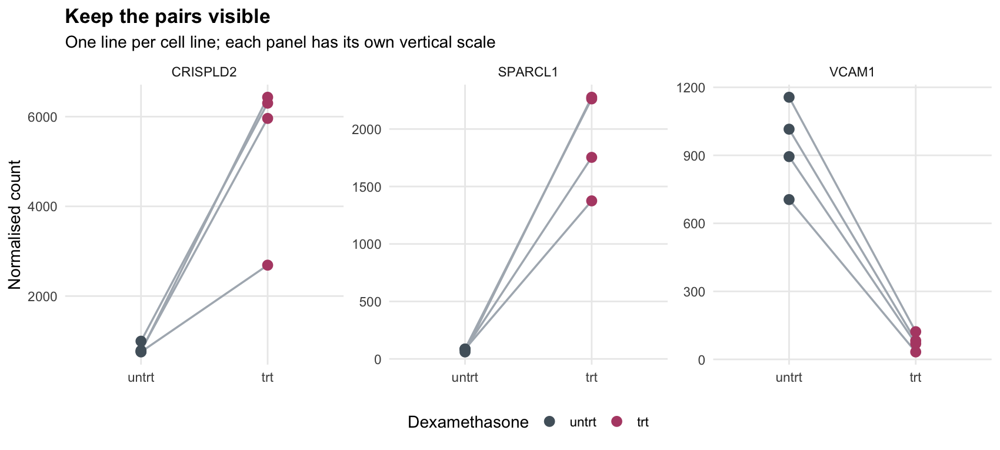
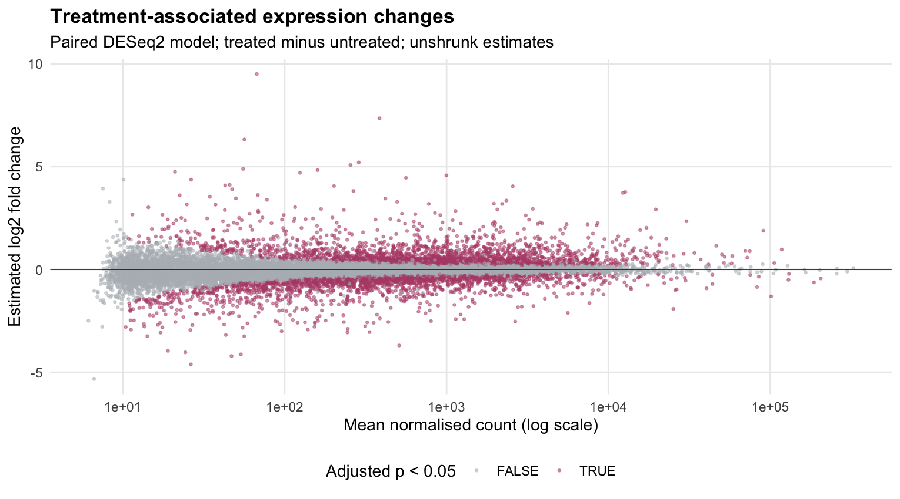

# Four Pairs, Thousands of Responses

*A paired RNA-seq reanalysis of dexamethasone-treated airway smooth-muscle cells.*

The first thing I wanted to preserve was the experiment's structure. These eight samples are four cell lines measured under two conditions. Treating them as eight unrelated samples would discard information that belongs in the analysis.



Each line connects the same cell line under the two conditions. The panels use separate vertical scales.

## Reading the response

I analysed the prepared **airway** count matrix with DESeq2, using `~ cell + dex` and a treated-minus-untreated contrast. Of 63,677 original gene rows, **16,139** passed the prespecified count filter. **4,081** had adjusted p-values below 0.05; **951** also had an estimated change of at least twofold in either direction. That twofold flag describes the estimate; it is not a formal minimum-effect test.

| Gene | Estimated log2 change | Standard error, paired | Standard error, unpaired |
|---|---:|---:|---:|
| CRISPLD2 | +2.63 | 0.18 | 0.26 |
| SPARCL1 | +4.57 | 0.18 | 0.21 |
| VCAM1 | −3.70 | 0.19 | 0.33 |

I selected **CRISPLD2** in advance as the original study's reference gene. SPARCL1 and VCAM1 were selected by the smallest adjusted p-value among the remaining positive and negative responses, respectively. They are examples chosen by a documented rule, not an unbiased summary of every gene.

For these examples, the unpaired model gives similar directions but larger standard errors. The preferred model follows the paired design regardless of which produces smaller p-values. The full [comparison table](results/design-comparison.csv) includes both estimates and adjusted p-values.

## From an estimate to a biological question

Himes and colleagues investigated CRISPLD2 as a glucocorticoid-responsive gene and included functional experiments beyond RNA sequencing. My reanalysis reproduces an increase in its RNA abundance; it does not reproduce those functional experiments. [Original study](https://doi.org/10.1371/journal.pone.0099625).

SPARCL1's annotation places its protein in the extracellular-matrix context; VCAM1 is a cell-adhesion molecule. Their opposite RNA responses suggest follow-up questions about cellular interactions, but these counts cannot establish changes in protein abundance, tissue behaviour or a causal mechanism. [SPARCL1 annotation](https://www.ncbi.nlm.nih.gov/gene/8404), [VCAM1 annotation](https://www.ncbi.nlm.nih.gov/gene/7412).



The MA plot shows unshrunk effects. Low-abundance estimates deserve particular care. All retained genes had raw p-values, while **313 adjusted p-values were unavailable** after independent filtering. These remain `NA` in the export rather than being replaced by zero.

[Sample PCA](results/sample-variation.png) provides a descriptive view of variation. Neither visual separation nor a long list of significant genes substitutes for biological replication: this experiment has **four cell lines**, and it does not measure patient outcomes.

## Reproduce the analysis

With micromamba or a compatible conda installation, create the environment in a path **without spaces**:

```bash
micromamba create -f environment.yml -p /tmp/airway-analysis
micromamba run -p /tmp/airway-analysis Rscript analysis.R
```

Alternatively, install `airway`, `DESeq2` and `org.Hs.eg.db` through a compatible Bioconductor release, plus `ggplot2` and `jsonlite`, then run `Rscript analysis.R` from this repository.

The script validates sample identity, pairing, count values and contrast direction before exporting results. Both models use the same filtered genes. The [protocol](protocol.md), [package versions](results/package-versions.csv) and [session information](results/session-info.txt) record choices and the executed environment. Symbol annotations are secondary to preserved Ensembl identifiers.

## Data and methodological foundation

- **Dataset:** Bioconductor [airway](https://bioconductor.org/packages/airway/), object `airway`, version 1.30.0; original accession **GSE52778**. The package carries an LGPL licence. The code loads the distributed counts; raw reads and the original matrix are not copied into this repository.
- **Experiment:** Himes et al. (2014), *RNA-Seq Transcriptome Profiling Identifies CRISPLD2 as a Glucocorticoid Responsive Gene that Modulates Cytokine Function in Airway Smooth Muscle Cells*. [PLOS ONE, doi:10.1371/journal.pone.0099625](https://doi.org/10.1371/journal.pone.0099625).
- **Method:** Love, Huber & Anders (2014), *Moderated estimation of fold change and dispersion for RNA-seq data with DESeq2*. [doi:10.1186/s13059-014-0550-8](https://doi.org/10.1186/s13059-014-0550-8); [official DESeq2 workflow](https://bioconductor.org/packages/release/bioc/vignettes/DESeq2/inst/doc/DESeq2.html).
- **Annotation and implementation:** org.Hs.eg.db/AnnotationDbi, SummarizedExperiment, R and ggplot2. Annotation versions are saved; ambiguous mappings use the first returned symbol while retaining the unique Ensembl key.

This is an educational secondary analysis. My focus is the relationship between experimental design, statistical uncertainty and the limits of biological interpretation.
